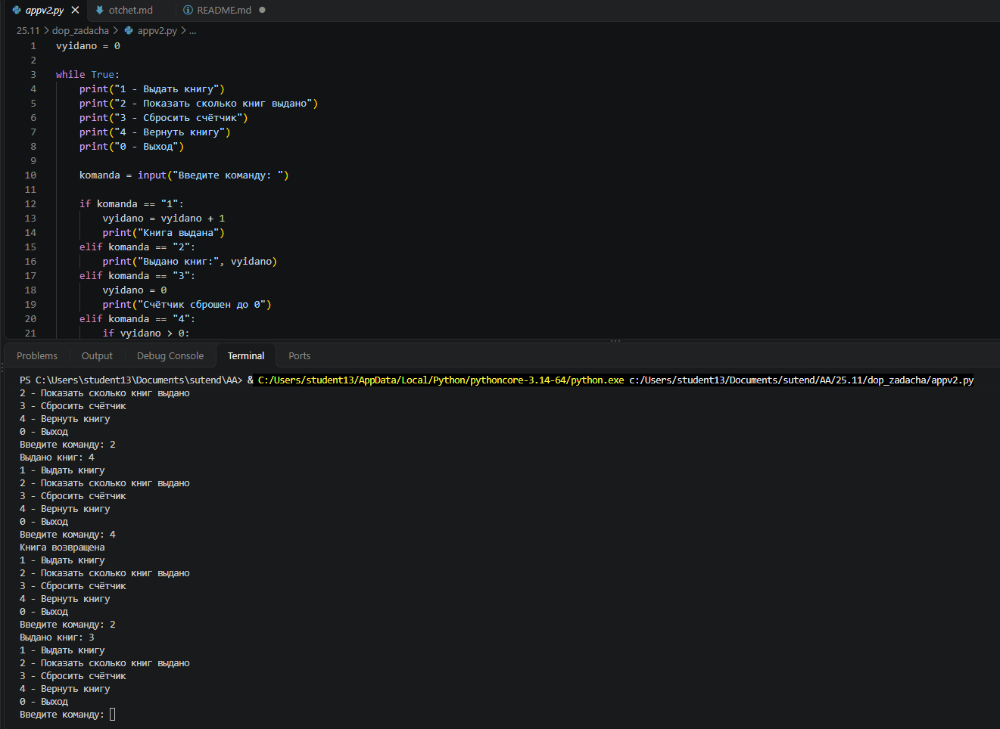
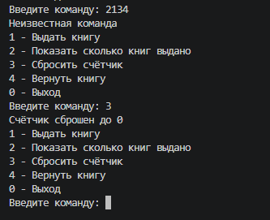

# Автор
* Ананьев Александр 12ТЭС
# Файлы проекта
* `app_v1.py` - первая версия программы для учёта книг
* `app_v2.py` - обновлённая версия с возвратом книг
* `otchet.md` - отчёт по регрессионному тестированию

# О проекте
Консольная программа на Python для подсчёта выданных книг. В первой версии можно выдавать книги, смотреть количество и сбрасывать счётчик. Во второй версии добавлена команда возврата книги.

# Запуск
1. Скачайте репозиторий: `git clone https://github.com/PKO-LP/dop-zadacha-25.11.git`
2. Откройте cmd в папке с файлом и напишите `python app_v2.py`

# Как пользоваться меню
* `1` - выдать одну книгу
* `2` - показать сколько книг выдано
* `3` - сбросить счётчик до 0
* `4` - вернуть одну книгу (только в v2)
* `0` - выход из программы

# Скриншоты программы

